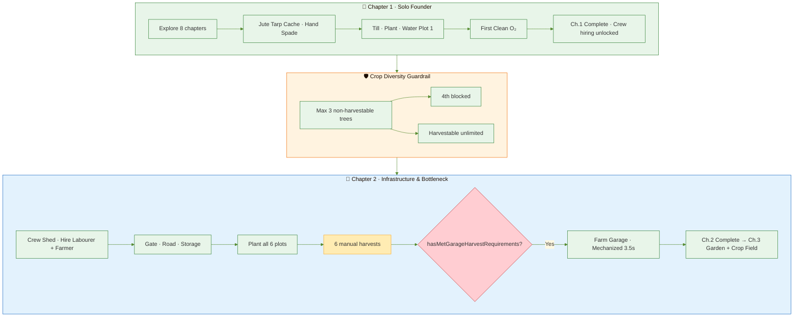
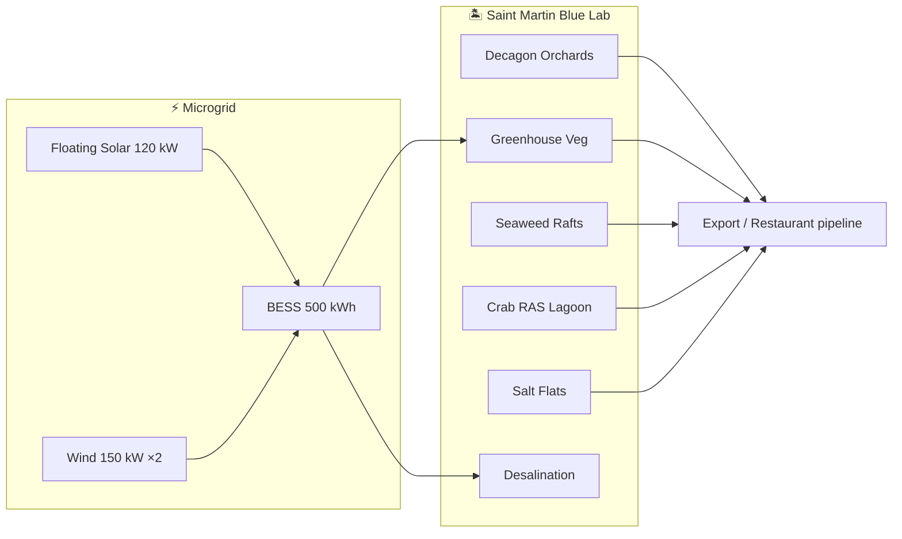
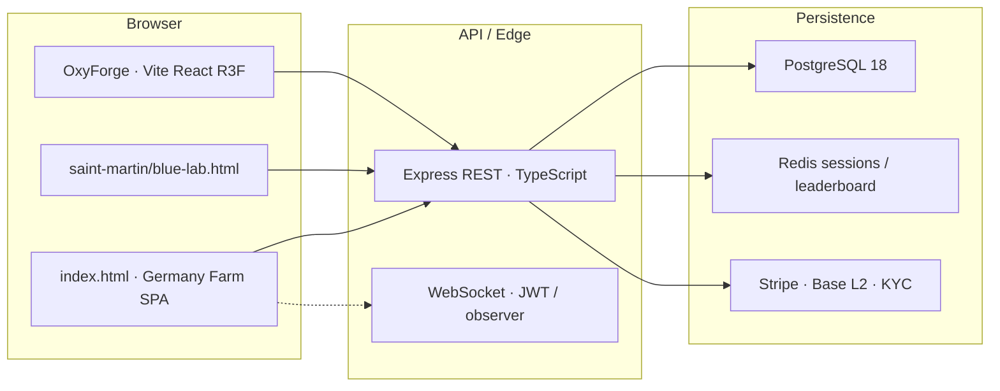
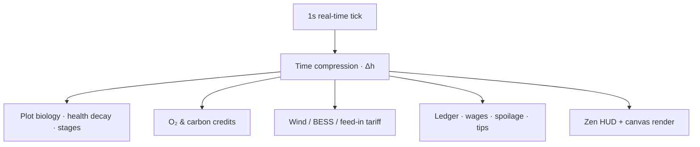
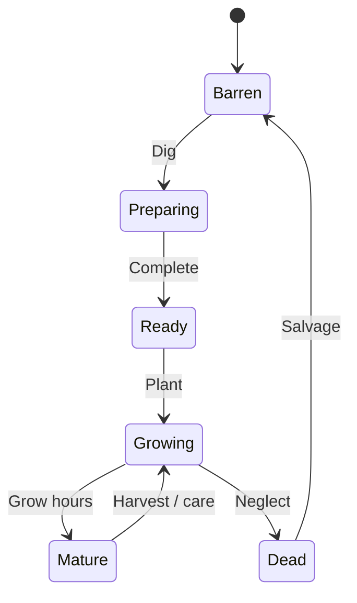

# 🌿 searchO2 — Regenerative Agroforestry, Clean Energy & Oxygen Economy Simulation

[](https://searcho2.online)
[](LICENSE)
[](index.html)
[](saint-martin/blue-lab.html)
[](backend/)
[](backend/)

> **searchO2** is an educational browser simulation of regenerative agroforestry, clean microgrids, and a virtual oxygen economy. Players restore barren land into a self-sustaining eco-village, unlock planetary biomes (including **Saint Martin's Island · Blue Lab**), and bridge into **OxyForge** off-Earth missions.

---

## 🆕 Latest Updates

### 2026-10-13 · Blue Lab — Greenhouse, Salt Flats & 3D Scale
- Greenhouse **vegetable farm** in real-time 3D isometric space
- **S-curve 5-pan salt flats** and wind-turbine placement fixes
- **1.09× scale normalization** for Blue Lab assets
- Scoreboard icon dashboard, streamlined HUD, meadow orchard alignment
- Species-unique **3D VR planting engine** and hover About Board

### 2026-10-12 · Blue Lab — Volumetric 3D Assets & Build-from-Scratch
- Authentic 3D isometric VR assets (Solar, Seaweed, Silos, BESS, Crab RAS, Salt Beds, Desalination, Vegetable, Flower, Garage, Crew Shed, Turbines)
- Decagon 2 meadow positioning; curvy country roads Pier → Decagon 2 → BESS
- German-farm **build-from-scratch** progression with Ecological & Engineering **Why Cards**
- 3D timber scaffolding + live countdown during construction
- **1× / 2× / 5×** zoom with pointer drag-pan

### 2026-10-09 · Chapter 1–2 Progression Overhaul (Germany Farm)
| Feature | Description |
|:---|:---|
| **Ch.1 Solo Founder** | Crew Shed hidden from Step 1 / active guide; buildings & hiring locked until first O₂ |
| **Crop Diversity Guardrail** | Max **3 non-harvestable** trees; 4th blocked; harvestable crops unlimited |
| **Manual Harvest Bottleneck** | **6 manual harvests** (≥3 harvestable plots × 2) before Farm Garage unlocks |
| **Farm Garage Gate** | €350 · 4 h · ≥1 Labourer; 2 Labourers → 2× build speed |
| **Mechanized Harvest** | After garage: **3.5 s** harvests; `mechanizedHarvestDone` completes Ch.2 → unlocks Ch.3 |



---

## 📑 Table of Contents
1. [Core Concepts](#-core-concepts)
2. [Gameplay Quickstart (Germany Farm)](#-gameplay-quickstart-germany-farm)
3. [Chapter Roadmap (1–8)](#-chapter-roadmap-18)
4. [Saint Martin's Island · Blue Lab](#-saint-martins-island--blue-lab)
5. [Architecture & System Flows](#-architecture--system-flows)
6. [Game Systems & Features](#-game-systems--features)
7. [Technical Stack](#-technical-stack)
8. [Getting Started](#-getting-started)
9. [Testing](#-testing)
10. [Contributing & License](#-contributing--license)

---

## 🌍 Core Concepts

```
  [Barren Land] → [Soil Prep] → [Agroforestry & Polyculture]
        ↑                              ↓
  [Eco Restoration] ← [Village] ← [O₂ Economy + Clean Energy]
```

| Pillar | In-game meaning |
|:---|:---|
| **💰 Money** | Capital for seeds, buildings, labour, roads, spaceflight |
| **🌿 O₂** | Photosynthetic output → municipal green credits (~€0.03/unit) |
| **🧠 Knowledge XP** | Eco Beginner → Planetary Ecologist (levels 1–5) |
| **⭐ Experience** | Chapter 1–8 milestones (Earth → Moon/Mars) |

Educational, COPPA-friendly (ages 8+): no loot boxes, no open chat, authentic botanical Latin names, guest + offline catch-up.

---

## 🎮 Gameplay Quickstart (Germany Farm)

1. **Survey** — Start with €10,000 GC, 6 plots, Central European Grassland.
2. **Dig** — Barren → preparing → ready soil (€15 · 3 h).
3. **Plant** — Fruit (Apple), vegetable (Tomato), oxygen tree (Oak), or timber (Cedar).
4. **Care** — Water (+30% hydration), prune (+20% vigor), drip irrigation (+15% growth).
5. **Store** — Build Storage Barn before large harvests (else 50% spoilage).
6. **Mechanize** — Complete 6 manual harvests → build **Farm Garage** → 3.5 s mechanized harvests.
7. **Expand** — Garden (3-sector decagon), crop field, cattle/sheep silvopasture, pond, 4 wind turbines + 500 kWh BESS, juice bar & coffee shop, Eco-Passport biomes, OxyForge space.

---

## 📖 Chapter Roadmap (1–8)

| Ch | Title | Key unlocks |
|:--:|:---|:---|
| 1 | 🌱 Solo Founder | Plot 1, first O₂, jute cache tools |
| 2 | 🚜 Build Your Farm | Crew, gate, road, storage, 6 plots, **manual harvest bottleneck**, garage |
| 3 | 🌳 Ecosystem | Decagonal flower garden, polyculture crop field, nature walkway |
| 4 | ♻️ Close the Loop | Cattle/sheep pasture, compost, freshwater pond |
| 5 | ⚡ Power Community | 4-corner wind turbines, engineer, 500 kWh BESS |
| 6 | 🏘️ Eco-Village | Juice bar, coffee house, marketplace promenade |
| 7 | 🌍 Self-Sustaining | Sustainability dashboard 80+, Eco-Passport biomes |
| 8 | 🚀 Beyond Earth | Space Science L4, funding, Moon/Mars hydroponics, 3D FPV |

**Object unlock path:** Plot/Solo Founder → Crew/Road/Storage/Garage → Garden/Crops → Cattle/Pond → Wind/BESS → Cafés → Eco-Passport → Artemis.

---

## 🇧🇩 Saint Martin's Island · Blue Lab

Coastal regenerative biome (globe → **Saint Martin's Island · Blue Lab**). Entry: `saint-martin/blue-lab.html` (also under `public/saint-martin/`).

### Facilities (build-from-scratch)
| Facility | Role |
|:---|:---|
| Twin **decagonal orchards** (dec1 / dec2) | Coconut, Palmyra, Keya, Mangrove, Casuarina |
| **Greenhouse vegetable farm** | Real-time 3D isometric cultivation |
| **Seaweed mariculture rafts** | Offshore biomass |
| **Freshwater lake & mud crab RAS** | Aquaculture lagoon |
| **Offshore floating solar (120 kW)** | Clean generation |
| **Wind turbines N/E (150 kW each)** | Clean generation |
| **Microgrid BESS (500 kWh)** | Storage & grid buffer |
| **Salt brine evaporator flats** | S-curve 5-pan salt production |
| **Desalination core & silos** | RO freshwater buffer |
| Crew shed, garage, flower beds | Labour & aesthetics |

### UX
- Scoreboard HUD (O₂, money, BESS kWh, salt, crab, seaweed chips)
- **1× / 2× / 5×** zoom + drag-pan
- 3D volumetric isometric assets; scaffolding + countdown while building
- **Why Cards** (ecological + engineering) per facility
- Boat cinematic, dive gallery (coral education: Acropora, Favites, …), meadow road routing



---

## 🏗 Architecture & System Flows

### Platform stack



### Core simulation tick (Germany)



### Plot lifecycle



---

## 🧩 Game Systems & Features

### Germany farm (`index.html`)
- **6 cultivable plots** with health, water, prune, drip irrigation
- **Tree taxonomy** — Germany + Nordic / Brazil / Spain biome catalogs (Latin names)
- **3-sector decagonal flower garden** — dual/full guild pollinator bonuses; bees & butterflies
- **Octagonal crop field** — 4-quadrant polyculture
- **Cattle & sheep silvopasture** — manure loop
- **4-corner wind turbines** (bird-safe) + **500 kWh LFP BESS** (€0.15/kWh feed-in)
- **Logistics** — Manhattan roads, harvest carts, storage cold-chain
- **Village** — juice bar, coffee shop, visitor foot-traffic remarks
- **Knowledge** — Why? (Quick / Learn More / Deep Dive), discovery cards, non-punitive quizzes
- **Oxy companion** — Guided / Balanced / Explorer
- **Procedural Web Audio** soundtrack & SFX

### Progression & anti-cheat
- Server-authoritative farm intents (prep, plant, harvest)
- Guest → register merge; JWT sessions
- Append-only economy ledger + audit

### OxyForge
- Space mission HQ, Moon/Mars closed-loop hydroponics, 3D FPV flight
- Bridge from Ch.8 / globe / FAB

---

## 🛠 Technical Stack

| Layer | Tech |
|:---|:---|
| Farm client | Single-file SPA: HTML5, CSS3, Canvas 2D, Web Audio |
| Blue Lab | `saint-martin/blue-lab.html` — Canvas isometric 3D-style assets |
| OxyForge | Vite + React + R3F + Zustand (`npm run dev`) |
| API | Node.js, Express, TypeScript (`backend/`) |
| DB | PostgreSQL 18 migrations; Redis cache/sessions |
| Auth | bcrypt, JWT, Google Sign-In, guest upgrade |
| Payments | Stripe / Base L2 / KYC hooks (module present) |
| Tests | Jest (backend); Playwright/node suites under `tests/` |

---

## 🚀 Getting Started

```bash
# Clone
git clone https://github.com/mishu-anik23/searchO2.git
cd searchO2

# Farm SPA (static)
npx serve . -p 3000
# open http://localhost:3000/index.html
# Blue Lab: http://localhost:3000/saint-martin/blue-lab.html

# Backend
cd backend
cp .env.example .env   # set DATABASE_URL, REDIS, JWT secrets
npm install
npm run db:migrate
npm run dev            # http://localhost:5000

# Full OxyForge (Vite)
cd .. && npm install && npm run dev
```

See [HOW_TO_RUN.md](HOW_TO_RUN.md) for more.

---

## 🧪 Testing

```bash
cd backend && npm test          # API / auth / ledger / farm anti-cheat
# Frontend progression & Blue Lab
node tests/test_ch2_bottleneck_guardrail_mechanization.js
node tests/test_saint_martin_blue_lab_suite.js
node tests/test_blue_lab_blueprint_and_modals.js
```

---

## 🤝 Contributing & License

1. Fork → feature branch → PR  
2. Keep chapter gates and educational tone intact  
3. Prefer tests for progression and Blue Lab layout changes  

**License:** [MIT](LICENSE)

---

<p align="center">
  <b>searchO2</b> — Regenerative agroforestry, clean energy, Blue Lab coasts, and planetary stewardship. 🌲💨🔋🏝️🚀
</p>
