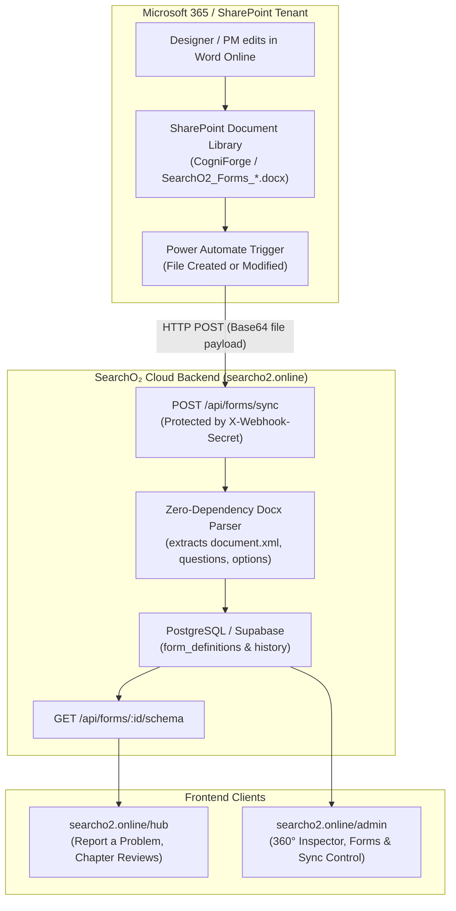

# SharePoint to SearchO₂ Live Hub Auto-Update Pipeline

This pipeline automatically synchronizes Word document form templates (e.g. `SearchO2_Forms_Import_04_Report_a_Problem.docx`) saved in SharePoint directly to the live game website at `searcho2.online/hub`.

Whenever a form is edited and saved in Microsoft 365 SharePoint / Word Online, the new questions, multiple-choice options, and field rules are parsed, versioned in the database, and reflected on `searcho2.online/hub` with **zero code redeployment** and **zero downtime**.

---

## 1. Architecture & Data Flow



---

## 2. Ingestion Webhook Specification

The SearchO₂ backend exposes a secure, high-throughput webhook endpoint specifically designed for SharePoint and Microsoft 365 cloud flows:

- **Endpoint**: `POST https://searcho2.online/api/forms/sync`
- **Authentication**: `X-Webhook-Secret: <SECRET>` (configured in server environment variable `FORMS_SYNC_SECRET`)
- **Accepted Payloads**:

### A. Base64 Document Payload (Power Automate / Logic Apps)
```json
{
  "filename": "SearchO2_Forms_Import_04_Report_a_Problem.docx",
  "contentBase64": "UEsDBBQABgAIAAAAIQ...",
  "updatedBy": "Editor Name / PowerAutomate"
}
```

### B. Direct JSON Schema Payload
```json
{
  "formId": "problem",
  "title": "SearchO₂ Report a Problem",
  "schema": {
    "sections": [...],
    "questions": [...]
  },
  "updatedBy": "admin_console"
}
```

### Success Response (`200 OK`)
```json
{
  "ok": true,
  "message": "Successfully parsed and synced form from SharePoint document payload",
  "formId": "problem",
  "version": 3,
  "title": "SearchO₂ Report a Problem",
  "questionsCount": 9,
  "syncedAt": "2026-10-28T09:50:00.000Z"
}
```

---

## 3. Setup Option A (Recommended): 3-Minute Power Automate Flow

Power Automate is the native Microsoft 365 integration method. It requires **no Azure App Registration** and runs automatically inside tenant `artifactz.sharepoint.com`.

### Step-by-Step Instructions:

1. Sign into **Microsoft Power Automate** ([make.powerautomate.com](https://make.powerautomate.com)) with your `artifactz.sharepoint.com` corporate account.
2. Click **Create** ➔ **Automated Cloud Flow**.
3. Name your flow: `SearchO2 Forms SharePoint Sync`.
4. Choose the trigger: **When a file is created or modified in a folder** (SharePoint).
5. Configure the trigger parameters:
   - **Site Address**: `https://artifactz.sharepoint.com/sites/CogniForge`
   - **Folder Id**: Select the folder holding `SearchO2_Forms_Import_04_Report_a_Problem.docx` (e.g. `/Shared Documents/Game Forms`).
6. Click **+ New step** ➔ Add action: **Get file content** (SharePoint).
   - **Site Address**: `https://artifactz.sharepoint.com/sites/CogniForge`
   - **File Identifier**: Select `File identifier` dynamic content from Trigger.
7. Click **+ New step** ➔ Add action: **HTTP** (HTTP Connector).
   - **Method**: `POST`
   - **URI**: `https://searcho2.online/api/forms/sync`
   - **Headers**:
     - `Content-Type`: `application/json`
     - `X-Webhook-Secret`: `searcho2_sharepoint_forms_secret_2026` (or your custom secret from `.env`)
   - **Body**:
     ```json
     {
       "filename": "@{triggerOutputs()?['body/{FilenameWithExtension}']}",
       "contentBase64": "@{body('Get_file_content')['$content']}",
       "updatedBy": "@{triggerOutputs()?['body/Editor/DisplayName']}"
     }
     ```
8. Click **Save** and test by saving a change in Word Online!

---

## 4. Setup Option B: Microsoft Graph API Poller / Cron

If you prefer a headless server worker or container to pull from SharePoint via Microsoft Graph API:

1. Register an App in **Microsoft Entra ID** (Azure AD):
   - Tenant ID: `d91ab6ed-4a28-4f00-9d1e-29cd1c9731bf`
   - API Permission: `Sites.Read.All` or `Files.Read.All` (Application permission).
   - Generate a Client Secret.
2. Set environment variables on your server:
   ```env
   AZURE_TENANT_ID=d91ab6ed-4a28-4f00-9d1e-29cd1c9731bf
   AZURE_CLIENT_ID=your-client-id
   AZURE_CLIENT_SECRET=your-client-secret
   SHAREPOINT_SITE_ID=artifactz.sharepoint.com,sites/CogniForge
   SHAREPOINT_FILE_ID={9D9EDD7D-ED90-4CF5-B0D9-6B09032EA298}
   SEARCHO2_API_BASE=https://searcho2.online
   FORMS_SYNC_SECRET=searcho2_sharepoint_forms_secret_2026
   ```
3. Run the automated poller:
   ```bash
   node scripts/sync_sharepoint_forms.mjs --graph
   ```

---

## 5. Setup Option C: GitHub Actions CI/CD Sync

The workflow `.github/workflows/sync-sharepoint-forms.yml` is already configured in the repository:
- Runs automatically daily or on `workflow_dispatch`.
- Can be triggered instantly by Microsoft 365 via a GitHub `repository_dispatch` webhook event (`types: [sharepoint_doc_updated]`).
- Pulls the latest SharePoint template and commits it to the repository to maintain revision control.

---

## 6. Admin Dashboard Manual Sync

You can also trigger a sync directly from the Admin Dashboard:
1. Open `https://searcho2.online/admin/dashboard.html`.
2. Navigate to **Player Feedback & Problem Reports**.
3. Click the **🔄 Sync Forms** button in the top right.
4. The backend immediately reads the latest document templates, updates database versions, and displays a confirmation dialog.

---

## 7. Database Table Schema

Stored in PostgreSQL migration `011_dynamic_form_schemas.sql`:

```sql
CREATE TABLE form_definitions (
    id VARCHAR(64) PRIMARY KEY, -- 'problem', 'chapter_feedback', 'playtest_review'
    title VARCHAR(255) NOT NULL,
    description TEXT,
    version INT NOT NULL DEFAULT 1,
    source_file VARCHAR(255),
    schema JSONB NOT NULL DEFAULT '{}'::jsonb,
    synced_at TIMESTAMPTZ NOT NULL DEFAULT NOW(),
    updated_by VARCHAR(120) DEFAULT 'sharepoint_pipeline'
);

CREATE TABLE form_definition_history (
    id UUID PRIMARY KEY DEFAULT uuid_generate_v4(),
    form_id VARCHAR(64) NOT NULL REFERENCES form_definitions(id) ON DELETE CASCADE,
    version INT NOT NULL,
    source_file VARCHAR(255),
    schema JSONB NOT NULL,
    synced_at TIMESTAMPTZ NOT NULL DEFAULT NOW(),
    updated_by VARCHAR(120)
);
```
